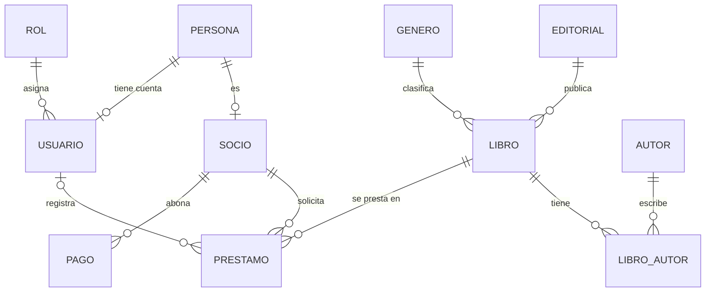

# 🗄️ Guía de Exposición: Base de Datos MySQL (`biblioteca.sql`)

Esta guía está pensada para quien exponga la **Capa de Datos** en la defensa del Trabajo Práctico Final (*Metodología de Sistemas II*). Incluye qué mostrar, el orden sugerido para hablar y las respuestas técnicas a las preguntas del tribunal.

---

## 1. Apertura: Visión General del Modelo
> **💡 Qué decir al empezar:**
> *"Diseñamos una base de datos relacional en MySQL/MariaDB llamada `biblioteca` compuesta por **11 tablas normalizadas** (superando ampliamente el mínimo de 4 requerido), con claves primarias autoincrementales, claves foráneas con integridad referencial (`ON UPDATE CASCADE`), restricciones `UNIQUE` para evitar duplicados y **2 procedimientos almacenados transaccionales** con manejo de `COMMIT` y `ROLLBACK`."*

---

## 2. Explicación por Módulos (Normalización e Integridad)

### A. Personas, Socios, Usuarios y Roles (`persona`, `socio`, `usuario`, `rol`)
* **Por qué existe `persona` separada de `socio` y `usuario`:**
  * Centraliza `numero_documento` (`UNIQUE`), `nombre`, `apellido`, `direccion`, `telefono` y `correo_electronico`.
  * Permite que una misma persona pueda ser empleado del sistema (`usuario`) y lector (`socio`) sin duplicar sus datos personales (cumple con 2FN y 3FN).
  * Tanto `socio.id_persona` como `usuario.id_persona` tienen restricción `UNIQUE`, asegurando una relación **1 a 1** y evitando que un mismo DNI se dé de alta dos veces como socio o como usuario.
* **Tabla `rol`:**
  * Relación **1 a N** con `usuario`. Almacena los roles `ADMIN` y `BIBLIOTECARIO` para el control de acceso (RBAC).
  * En `usuario`, las contraseñas nunca se guardan en texto plano sino en `clave_hash` (SHA-256).

### B. Catálogo Bibliográfico y Tabla Intermedia (`editorial`, `genero`, `autor`, `libro`, `libro_autor`)
* **Tablas Maestras (`editorial`, `genero`, `autor`):**
  * Evitan repetir textos como `"Editorial Sudamericana"` o `"Ciencia Ficción"` en miles de filas de `libro`, garantizando consistencia y facilitando correcciones desde un único registro.
* **Tabla Principal `libro`:**
  * Almacena `isbn` (`UNIQUE`), `titulo`, `anio_publicacion`, las claves foráneas `id_editorial` e `id_genero`, y el control de inventario mediante **`stock_total`** y **`stock_disponible`**.
* **⭐ Tabla Intermedia `libro_autor` (Relación `N:M`):**
  * **Cómo explicarla:** *"Un libro puede tener varios coautores (por ejemplo, 'Fundamentos de Bases de Datos' de Abraham Silberschatz y Henry Korth) y un autor puede escribir múltiples libros. En el modelo relacional, una relación Muchos a Muchos exige una tabla intermedia. Su clave primaria es **compuesta** `(id_libro, id_autor)`, lo que impide asignar dos veces el mismo autor al mismo libro."*
  * `fk_libroautor_libro` usa `ON DELETE CASCADE` (si se borra el libro, se borra su vínculo en `libro_autor`) y `fk_libroautor_autor` restringe borrar autores que tengan libros asociados.

### C. Operaciones (`prestamo` y `pago`)
* **Tabla `prestamo`:**
  * Vincula `id_socio`, `id_libro` e `id_usuario` (con `ON DELETE SET NULL` para no perder historial si se diera de baja un operador).
  * Registra `fecha_prestamo`, `fecha_devolucion_pactada`, `fecha_devolucion_real` (inicia en `NULL`) y `estado` (`ENUM('ACTIVO', 'DEVUELTO', 'VENCIDO')`).
  * **Por qué no hay una tabla `devolucion` aparte:** Porque la devolución es el cierre del ciclo de vida del préstamo (pasa de `ACTIVO` a `DEVUELTO` y se completa `fecha_devolucion_real`).
* **Tabla `pago`:**
  * Registra `id_socio`, `periodo`, `monto` (`DECIMAL(10,2)`), `fecha_pago` y `estado` (`ENUM('PENDIENTE', 'PAGADO', 'ANULADO')`).

---

## 3. Procedimientos Almacenados Transaccionales (`COMMIT` / `ROLLBACK`)

> **📌 Requisito clave del TP:** Se implementaron **2 Stored Procedures** en [biblioteca.sql](file:///c:/Users/Juan/Documents/Proyectos/React/biblioteca/biblioteca.sql#L233-L371), ambos invocados en vivo desde FastAPI.

### 1) `sp_registrar_prestamo`
* **Parámetros:** `IN p_id_socio`, `IN p_id_libro`, `IN p_id_usuario`, `IN p_fecha_prestamo`, `IN p_fecha_devolucion_pactada`, `IN p_observaciones`, `OUT p_id_prestamo`.
* **Cómo funciona internamente:**
  1. Declara `DECLARE EXIT HANDLER FOR SQLEXCEPTION BEGIN ROLLBACK; RESIGNAL; END;` para revertir ante cualquier error SQL inesperado.
  2. Inicia la transacción con `START TRANSACTION`.
  3. Valida que `p_fecha_devolucion_pactada >= p_fecha_prestamo`; si falla, hace `ROLLBACK` y lanza `SIGNAL SQLSTATE '45000'`.
  4. Bloquea las filas afectadas con **`SELECT ... FOR UPDATE`** para evitar condiciones de carrera si dos bibliotecarios prestan el último ejemplar al mismo tiempo.
  5. Verifica que el socio exista y esté en estado `'ACTIVO'`, y que `libro.stock_disponible > 0`.
  6. Descuenta 1 al `stock_disponible`, inserta el registro en `prestamo`, guarda `LAST_INSERT_ID()` en `p_id_prestamo` y confirma con **`COMMIT`**.

### 2) `sp_registrar_devolucion`
* **Parámetros:** `IN p_id_prestamo`, `IN p_fecha_devolucion_real`.
* **Cómo funciona:** Dentro de `START TRANSACTION` bloquea el préstamo con `FOR UPDATE`, valida que exista y no esté ya en `'DEVUELTO'`, actualiza `estado = 'DEVUELTO'` + `fecha_devolucion_real`, repone el stock con `LEAST(stock_total, stock_disponible + 1)` y confirma con **`COMMIT`** (o **`ROLLBACK`** ante error).

---

## 4. Consultas SQL para Reportes (`INNER JOIN`, Subconsultas, `GROUP BY`)
Si te preguntan cómo se explotan los datos en MySQL:
1. **Préstamos por Género:** `INNER JOIN` entre `prestamo`, `libro` y `genero` + `GROUP BY g.id_genero, g.nombre` con `COUNT`, `SUM(CASE ...)` y `COUNT(DISTINCT id_socio)`.
2. **Socios con deuda o préstamo activo:** `INNER JOIN` entre `socio`, `persona` y `pago` + subconsulta correlacionada en el `SELECT` + filtro `WHERE s.id_socio IN (SELECT ... UNION SELECT ...)` + `GROUP BY`.
3. **Libros destacados (demanda ≥ promedio):** `INNER JOIN` múltiple (5 tablas incluyendo `libro_autor`) + `GROUP_CONCAT` + `GROUP BY` + `HAVING veces_prestado >= (SELECT COALESCE(AVG(cnt), 0) FROM (...))`.

---

## 5. Checklist Rápido para Mostrar en phpMyAdmin durante la Defensa
1. Abrir **Diseñador** en phpMyAdmin para mostrar el Diagrama E/R y todas las llaves foráneas.
2. Mostrar la pestaña **Estructura** de `libro_autor` (clave primaria compuesta).
3. Mostrar la pestaña **Rutinas** en phpMyAdmin para enseñar `sp_registrar_prestamo` y `sp_registrar_devolucion` con su código `START TRANSACTION`, `COMMIT` y `ROLLBACK`.

